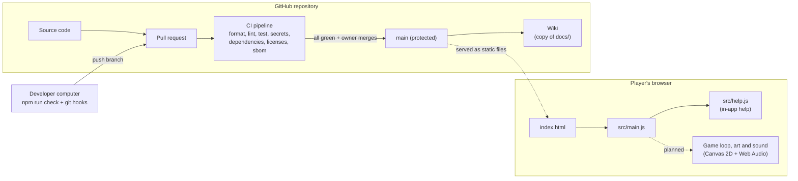

# Architecture

Runny Hound is a static web page: HTML, CSS and JavaScript modules that run entirely in
the player's browser. There is no server-side code, no database, no sign-in and no
cloud infrastructure. Graphics are drawn on a `<canvas>` with code and sounds are
synthesized with the Web Audio API, so there are no asset files.

## Pieces

| Path                  | What it is                                                           |
| --------------------- | -------------------------------------------------------------------- |
| `index.html`, `src/`  | The game. Only these files are shipped to players.                   |
| `src/help.js`         | Player help text shown in the Help dialog.                           |
| `test/`               | Automated tests (`node --test`).                                     |
| `scripts/`            | Project tools: local server, license check, SBOM, wiki publishing.   |
| `scripts/lib/`        | The logic behind those tools, kept separate so it can be tested.     |
| `license-policy.json` | Recorded usage and the allowed dependency licenses.                  |
| `sbom.cdx.json`       | Software bill of materials (CycloneDX), generated from the lockfile. |
| `.githooks/`          | Local checks: secret scan before commit, all checks before push.     |
| `.github/workflows/`  | The CI pipeline and wiki publishing.                                 |

## Dependencies

The game has **no runtime dependencies**. Everything in `package.json` is a
development tool (formatter, linter) that never reaches players. They are still
license-checked and vulnerability-scanned, because they run on our computers.

## Hosting

Not decided yet. Because the game is static files, any static host works (for example
GitHub Pages). Adding hosting is a change that needs its own issue and decision record.
