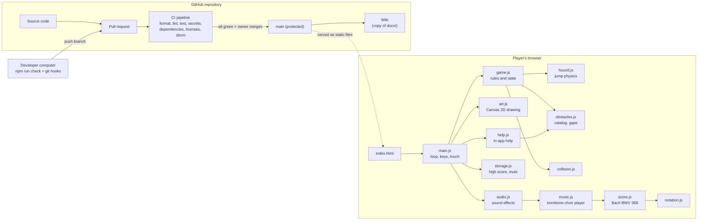

# Architecture

Runny Hound is a static web page: HTML, CSS and JavaScript modules that run entirely in
the player's browser. There is no server-side code, no database, no sign-in and no
cloud infrastructure. Graphics are drawn on a `<canvas>` with code and sounds are
synthesized with the Web Audio API, so there are no asset files.

## How a frame works

1. `main.js` asks the browser for a frame (`requestAnimationFrame`).
2. It advances the game in fixed steps of 1/120 s (`game.step`), so the game plays the
   same on a 60 Hz laptop and a 120 Hz phone. A long pause (switching tabs) is capped
   at 0.1 s so the hound doesn't teleport.
3. Each step returns events (`start`, `jump`, `milestone`, `crash`, `highscore`).
   `main.js` turns them into sounds, saves the high score, and updates a hidden
   screen-reader message.
4. `main.js` asks `shouldPlayMusic` whether music should be heard right now (running,
   not paused, music on, not muted) and tells the audio system. The music player
   schedules notes about 0.3 s ahead on the audio clock, so the music stays in time
   even when a frame is late.
5. `art.js` draws the whole scene from the game state. Drawing never changes the state.

The game logic (`game.js`, `hound.js`, `obstacles.js`, `collision.js`) has no browser
code at all, so it is tested directly in Node. Randomness comes from a seeded
generator (`random.js`), so tests can replay the same course. The key test is a
simulated player that jumps at the right moment and must survive two minutes on
several courses: that proves the game never generates an impossible sequence.

## Pieces

| Path                  | What it is                                                                                            |
| --------------------- | ----------------------------------------------------------------------------------------------------- |
| `index.html`          | The page: canvas, Help button and dialog, screen-reader status line.                                  |
| `src/main.js`         | Wires the browser to the game: loop, keyboard, touch, sound, saving.                                  |
| `src/game.js`         | Game rules: phases (ready, running, over), score, speed, spawning, crashes.                           |
| `src/hound.js`        | Jump physics and the hound's hitbox.                                                                  |
| `src/obstacles.js`    | The obstacle catalog (with fun facts), hitboxes, spacing rules.                                       |
| `src/collision.js`    | Box overlap test.                                                                                     |
| `src/config.js`       | Tuning numbers: world size, gravity, speeds, scoring.                                                 |
| `src/art.js`          | All drawing: sky, South Mountain star, skyline, snow, bricks, obstacles, hound, text.                 |
| `src/audio.js`        | Sound effects (start yips, jump chirp, milestone bell, crash) and the shared audio context.           |
| `src/music.js`        | Background music player: schedules notes ahead, loops, pauses/resumes; trombone voice.                |
| `src/score.js`        | _In dulci jubilo_, Bach BWV 368, in four parts ([decision 0004](decisions/0004-background-music.md)). |
| `src/notation.js`     | Reads the text notation used in `score.js` and checks every bar.                                      |
| `src/palette.js`      | Colors. The first four must match `src/style.css` (tested).                                           |
| `src/storage.js`      | High score and mute setting in `localStorage`, safe if blocked.                                       |
| `src/input.js`        | Key-to-action mapping.                                                                                |
| `src/help.js`         | Player help; the obstacle list is generated from `obstacles.js`.                                      |
| `test/`               | Automated tests (`node --test`).                                                                      |
| `scripts/`            | Project tools: local server, license check, SBOM, wiki publishing.                                    |
| `license-policy.json` | Recorded usage and the allowed dependency licenses.                                                   |
| `sbom.cdx.json`       | Software bill of materials (CycloneDX), generated from the lockfile.                                  |
| `.githooks/`          | Local checks: secret scan before commit, all checks before push.                                      |
| `.github/workflows/`  | The CI pipeline and wiki publishing.                                                                  |

## Tuning the game

Change numbers in `src/config.js` (speed, gravity) or obstacle sizes in
`src/obstacles.js`, then run `npm test`. If the "attentive player can survive" or
"every obstacle can be cleared" tests fail, the change made the game unfair.

## Adding an obstacle

1. Add an entry to `OBSTACLE_TYPES` in `src/obstacles.js` (id, name, size, fun fact).
2. Run `npm test`: the art test fails until you add a drawing function to
   `OBSTACLE_ART` in `src/art.js`. Help updates itself.
3. Check it in the browser with `npm start`.

## Dependencies

The game has **no runtime dependencies**. Everything in `package.json` is a
development tool (formatter, linter) that never reaches players. They are still
license-checked and vulnerability-scanned, because they run on our computers.

## Hosting

Not decided yet. Because the game is static files, any static host works (for example
GitHub Pages). Adding hosting is a change that needs its own issue and decision record.
